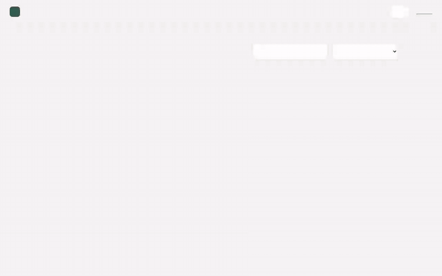
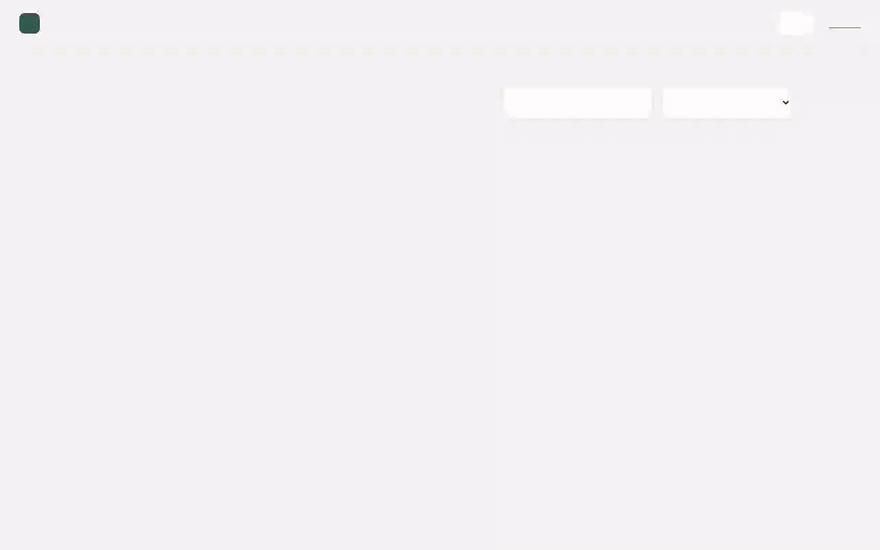
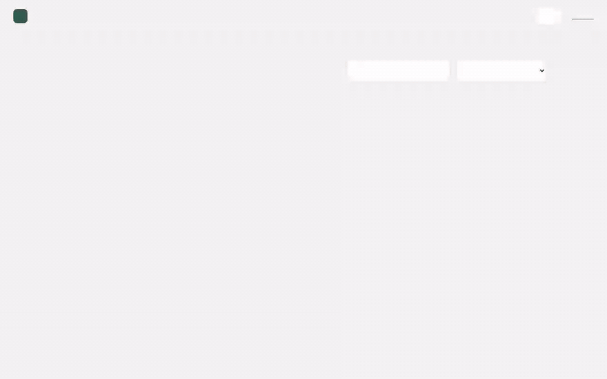
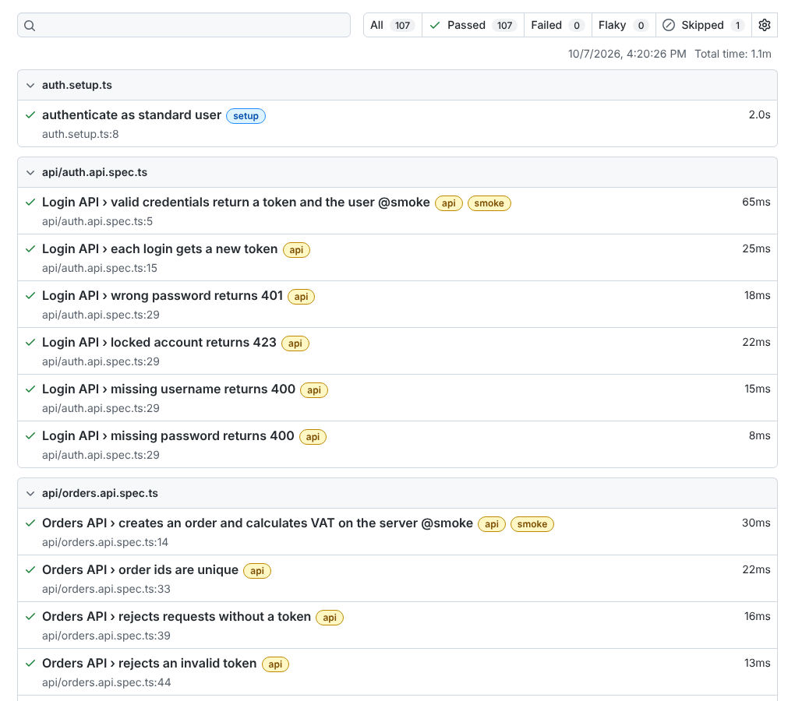
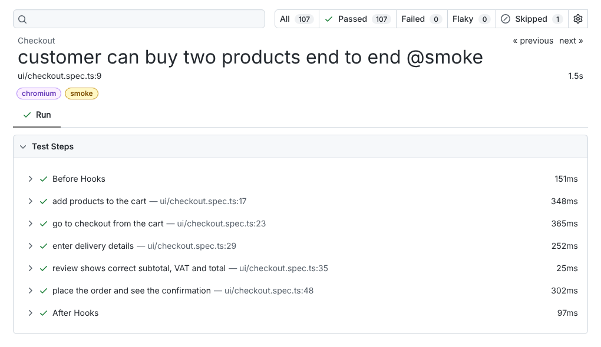
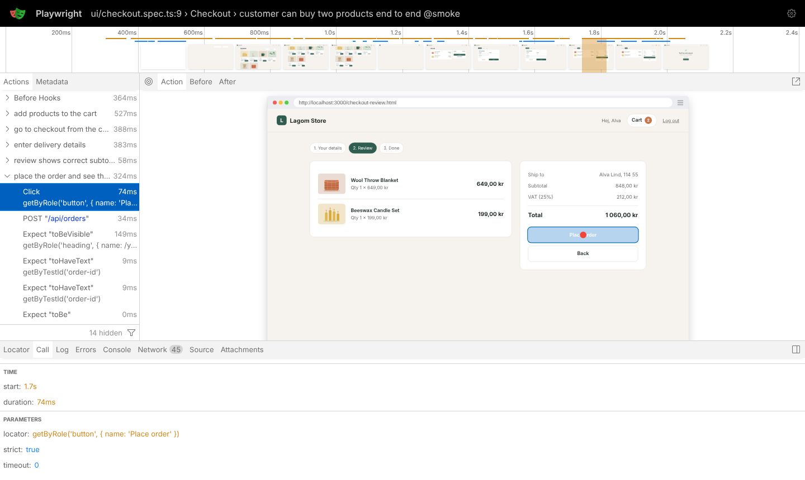
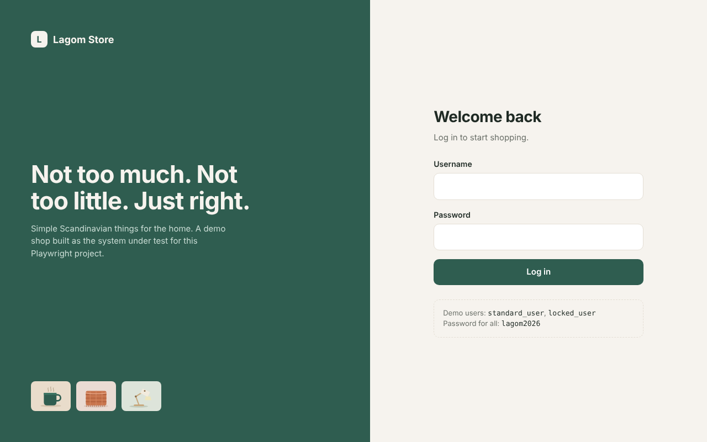
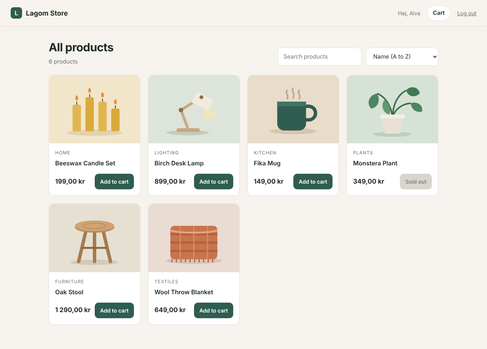

# Playwright E2E Automation: Lagom Store

[](https://github.com/sa-talha/playwright-ecommerce-automation/actions/workflows/playwright.yml)


A test automation framework for a small web shop, written with **Playwright and TypeScript**.
It covers the UI on desktop and mobile, the REST API behind it, visual regression and basic accessibility, and runs on every push in GitHub Actions across Chromium, Firefox and WebKit.

The shop itself (Lagom Store) is included in the repo, so the whole suite runs offline with one command and never fails because a third-party demo site changed.

<p align="center">
  
</p>

---

## Contents

- [What this project shows](#what-this-project-shows)
- [Test flows in action](#test-flows-in-action)
- [Reports and debugging](#reports-and-debugging)
- [Test coverage](#test-coverage)
- [Framework design](#framework-design)
- [Project structure](#project-structure)
- [Run it locally](#run-it-locally)
- [CI pipeline](#ci-pipeline)
- [The app under test](#the-app-under-test)

## What this project shows

| Skill | Where to look |
|---|---|
| Page Object Model with reusable components | [`src/pages`](src/pages), [`src/components/Header.ts`](src/components/Header.ts) |
| Custom fixtures (page objects, API client, cart seeding) | [`src/fixtures/test.ts`](src/fixtures/test.ts) |
| Log in once, reuse the session (storage state) | [`tests/auth.setup.ts`](tests/auth.setup.ts), [`playwright.config.ts`](playwright.config.ts) |
| Data-driven tests | [`tests/ui/checkout.spec.ts`](tests/ui/checkout.spec.ts), [`src/data/checkout.ts`](src/data/checkout.ts) |
| API testing (status codes, schema, business rules) | [`tests/api`](tests/api) |
| Network mocking and response capture | `page.route` in [`tests/ui/checkout.spec.ts`](tests/ui/checkout.spec.ts) |
| Visual regression | [`tests/visual`](tests/visual) |
| Accessibility and keyboard checks | [`tests/a11y`](tests/a11y) |
| Cross-browser and mobile emulation | `projects` in [`playwright.config.ts`](playwright.config.ts) |
| Readable reports with `test.step` | HTML report, trace viewer (see below) |
| CI with a browser matrix, merged report on GitHub Pages | [`.github/workflows/playwright.yml`](.github/workflows/playwright.yml) |

## Test flows in action

These GIFs are recorded from real test runs (`npm run record:demos`). Every recording also asserts, so a GIF only exists if the flow actually passed. The orange dot is the cursor and the caption shows the current step.

### Login: wrong password, locked account, then success


### Shopping: search, sort, sold-out items and the cart


### Validation and a mocked server error
The last step uses `page.route` to make the order API return `409 out of stock`, which is hard to reproduce against a real backend.



### Mobile checkout (Pixel 7 emulation)


## Reports and debugging

**HTML report.** Every run produces one. In CI the reports from all browsers are merged and published to GitHub Pages.



**Steps inside a test.** The end-to-end test is split with `test.step`, so the report reads like a test case.



**Trace viewer.** On a retry in CI a full trace is saved: every action, DOM snapshot, network call and console message.



## Test coverage

| Area | What is checked | Tests |
|---|---|---|
| Login (UI) | valid login, locked user, three kinds of bad credentials, empty fields, redirect when not logged in, logout clears the session | 9 |
| Products (UI) | full catalogue, 4 sort orders, live search, empty state, sold-out item, prices, detail page, unknown id | 12 |
| Cart (UI) | add items, change quantity, remove to zero, empty cart, reload keeps the cart, continue shopping | 6 |
| Checkout (UI) | full purchase with VAT maths, 5 invalid form inputs, mocked 409 error, empty-cart guard, back navigation keeps data | 9 |
| Accessibility | keyboard-only login, errors announced with `role="alert"`, alt text, labelled fields and buttons | 5 |
| API | health, product list schema, sort and search params, single product, 404, login 200/400/401/423, orders 201/400/401/409, unique order ids, server-side VAT | 22 |
| Visual | login, product list and cart screenshots compared to baselines | 3 |

The UI and accessibility tests run in **4 browser projects** (Chromium, Firefox, WebKit, Pixel 7), so one full run is **190 test executions**.

## Framework design

A few decisions worth calling out:

- **Locators a user would recognise.** Page objects use `getByRole` and `getByLabel` first, and `data-test` ids only where there is no good accessible name. A broken label then fails a test, which doubles as an accessibility check.
- **Log in once.** `auth.setup.ts` logs in through the real UI and saves the storage state. All UI projects depend on it, so tests start logged in and the login screen is only tested where it matters.
- **Set state directly, test behaviour through the UI.** The `seedCart` fixture writes the cart to `localStorage`. Checkout tests do not need to click through the product list first, which keeps them fast and focused on one thing.
- **Assert on numbers, not strings.** Prices are shown in Swedish format (`1 290,00 kr`). `parseSek()` turns them into numbers so tests can check that subtotal plus 25% VAT equals the total.
- **Capture what the browser really received.** The app navigates away right after placing an order, so the response body is gone before a normal `waitForResponse` can read it. The test routes the call through `route.fetch()` and keeps the real JSON.
- **Stable visual baselines.** The app ships its own font and visual tests run only on Chromium at a fixed viewport, with a small diff tolerance.
- **Fail with evidence.** Screenshots, video and traces are kept for failures and uploaded as CI artifacts.

## Project structure

```
.
├── app/                      Lagom Store, the system under test (Node.js, no dependencies)
│   ├── server.js             static files + JSON API
│   ├── data.js               users and products
│   └── public/               HTML, CSS, JS, images
├── src/
│   ├── api/ApiClient.ts      typed wrapper for the REST API
│   ├── components/Header.ts  shared header component
│   ├── data/                 users, products, checkout test data
│   ├── fixtures/test.ts      custom Playwright fixtures
│   ├── pages/                page objects
│   └── utils/money.ts        price parsing and rounding
├── tests/
│   ├── auth.setup.ts         log in once, save the session
│   ├── ui/                   login, products, cart, checkout
│   ├── api/                  products, auth, orders
│   ├── a11y/                 keyboard and accessibility checks
│   ├── visual/               screenshot comparison (+ __screenshots__ baselines)
│   └── demo/                 slowed-down flows recorded as GIFs
├── scripts/make-gifs.mjs     turns recorded videos into GIFs with ffmpeg
├── playwright.config.ts      projects, reporters, web server
├── playwright.demo.config.ts config for recording the demo GIFs
└── .github/workflows/        CI pipeline
```

## Run it locally

Requirements: Node.js 20 or newer.

```bash
git clone https://github.com/sa-talha/playwright-ecommerce-automation.git
cd playwright-ecommerce-automation
npm install
npx playwright install --with-deps
```

Playwright starts the shop automatically, so there is nothing else to run.

| Command | What it does |
|---|---|
| `npm test` | everything: API, all browsers, mobile, visual |
| `npm run test:chromium` | API, Chromium UI and visual only (fastest full check) |
| `npm run test:smoke` | only tests tagged `@smoke` |
| `npm run test:api` | API tests only |
| `npm run test:ui` | Playwright UI mode, good for debugging |
| `npm run test:headed` | watch the Chromium tests in a real browser window |
| `npm run report` | open the last HTML report |
| `npm run record:demos` | record the demo flows and rebuild the GIFs (needs ffmpeg) |
| `npm start` | run the shop on its own at http://localhost:3000 |

Update visual baselines on purpose after a design change:

```bash
npx playwright test --project=setup --project=visual --update-snapshots
```

## CI pipeline

On every push and pull request (and every Monday, to catch browser updates):

1. Six parallel jobs: `api`, `chromium`, `firefox`, `webkit`, `mobile-chrome` and `visual`. The API job also runs the TypeScript type check.
2. Each job saves a blob report. Screenshots, videos and traces are uploaded only when something fails.
3. A final job merges the blobs into one HTML report and, on `main`, publishes it to GitHub Pages.

Retries are set to 2 in CI with a trace on the first retry, so a flaky test shows up as "flaky" in the report instead of hiding.

## The app under test

Lagom Store is a small shop written for this project: login, product list with search and sort, product pages, cart, a three-step checkout and an order confirmation. It has a JSON API (`/api/products`, `/api/login`, `/api/orders`) with validation and stock rules, so there is real logic to test.

| User | Password | Behaviour |
|---|---|---|
| `standard_user` | `lagom2026` | normal shopping |
| `locked_user` | `lagom2026` | login is refused with 423 Locked |

| Screen | |
|---|---|
|  |  |

---

**Author:** Talha Sajjad, QA and test automation · [Portfolio](https://sa-talha.github.io)

Inter font by The Inter Project Authors, under the SIL Open Font License (see `app/public/fonts/OFL.txt`).
